 

---

### 👋 About

3rd-year B.Tech (AI) student at Newton School of Technology. I work where **finance meets data**: reading company filings, modelling risk, and turning messy numbers into dashboards people can act on. Currently looking for fintech and financial-services data roles.

### 🚀 Featured work

| Project | What it does | Stack |
|---|---|---|
| **[PlainLedger](https://github.com/gaurimehrotra1623/PlainLedger)** | Analyses SEC filings across 500+ public companies, with a Groq-powered assistant (*Milo*) that answers questions about them | Python, Pandas, Groq API |
| **[Alternative credit-risk modelling](https://github.com/gaurimehrotra1623?tab=repositories)** | Credit-risk model for gig-economy workers with no traditional credit history, using STL decomposition on income patterns | Python, statsmodels |
| **[International Student Career Outcomes](https://github.com/gaurimehrotra1623/International-Student-Career-Outcomes-Analysis-Python-Tableau-)** | Education, employment and salary trends, cleaned in Python and shown in an interactive Tableau dashboard | Python, Tableau |

### 🛠️ Toolkit

**Finance skills:** financial statement and SEC filing analysis · security analysis · portfolio management

### 🐍 Contribution snake

  <picture>
    <source media="(prefers-color-scheme: dark)" srcset="https://raw.githubusercontent.com/gaurimehrotra1623/gaurimehrotra1623/output/github-snake-dark.svg"/>
    
  </picture>

*Open to collaborations. Say hi on [LinkedIn](https://www.linkedin.com/in/gauri-mehrotra-008580324/).*

